# Project Prompts and Output

## 1. Constitution

### 1.1 Prompt Used

**Prompt:** 

```text
Create a simple project constitution for a Calorie and Nutrition Tracker application.

The application should allow users to:

Record daily meals, including breakfast, lunch, dinner, and snacks.
Enter meal details such as food name, calories, and protein.
Track total daily calorie and protein intake.
Set daily calorie and protein targets.
View daily progress by comparing actual intake against targets.
Include the following principles and constraints in the constitution:
Simplicity: Keep the application simple, user-friendly, and suitable for a fundamentals-level project.
Accuracy: Ensure calorie and protein calculations are accurate.
Data Validation: Validate user inputs and handle invalid or missing values appropriately.
Maintainability: Follow clean coding practices and maintain a clear project structure.
Usability: Provide a simple and understandable interface for recording meals and viewing nutrition progress.
Data Management: Store and retrieve meal records and daily nutrition targets consistently.
Testing: Validate all major functionalities, including normal inputs, invalid inputs, boundary conditions, and edge cases.
Error Handling: Display appropriate error messages and handle unexpected situations gracefully.
```

### 1.2 Output

**Screenshot:** 

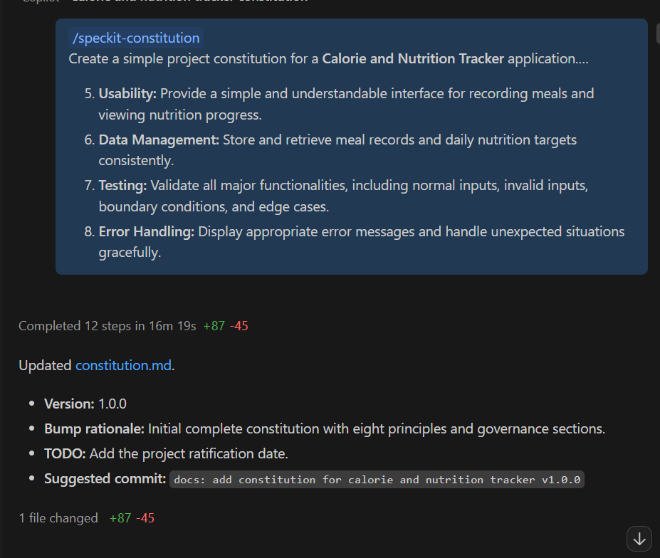

------------------------------------------------------------------------

## 2. Specify and Clarify

### 2.1 Prompt Used

**Prompt:**

```text
Create a functional specification for a Calorie and Nutrition Tracker application.

The application should allow users to:

- Add meals with food name, meal category (Breakfast, Lunch, Dinner, Snacks), calories, protein, and date.
- View, edit, and delete recorded meals.
- Track daily total calorie and protein intake.
- Set and update daily calorie and protein targets.
- Compare actual intake against daily targets.
- Display remaining or exceeded calories and protein using simple progress indicators.
Business Rules and Validation:

- Food name and meal category are required.
- Calories and protein must be non-negative numeric values.
- Daily targets must be positive numbers.
- Daily totals must update whenever meals are added, edited, or deleted.
- Handle empty meal records and missing nutrition targets appropriately.
- Display clear validation and error messages.
Scope and Constraints:

- Focus only on calorie and protein tracking.
- Users will manually enter food and nutrition details.
- Exclude authentication, barcode scanning, AI recommendations, and external food database integration.
- Keep the application simple and suitable for a fundamentals-level project.
Include project overview, target users, functional and non-functional requirements, business rules, assumptions, constraints, and uniquely identified acceptance criteria (AC-01, AC-02, etc.).

Ensure all acceptance criteria are specific and testable. Clearly mark any requirements that need business-owner clarification instead of making assumptions.
```

### 2.2 Output

**Screenshot:**

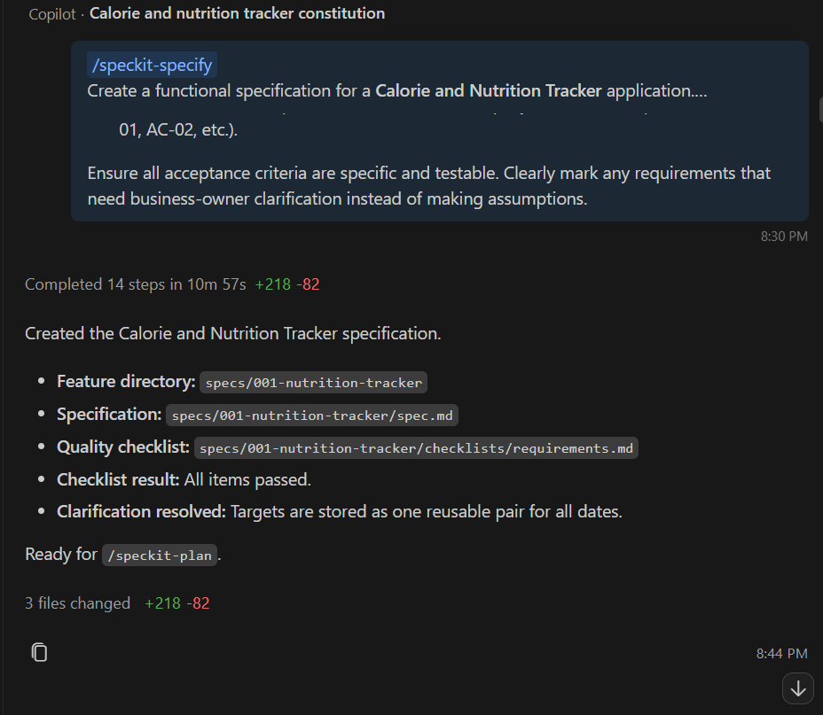

### 2.3 Clarify

**Screenshot:** 

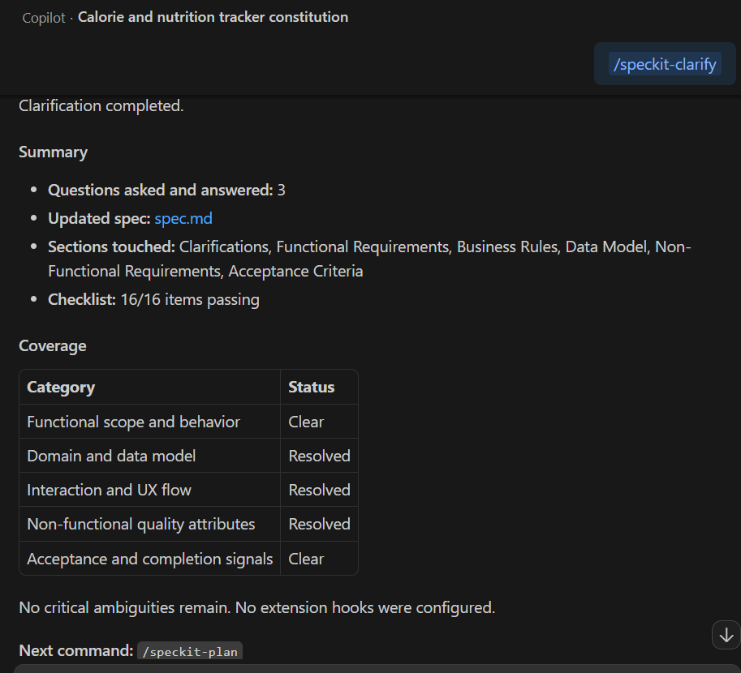

------------------------------------------------------------------------

## 3. Plan

### 3.1 Prompt Used

**Prompt:**

```text
Create a simple and practical technical implementation plan for the **Calorie and Nutrition Tracker** based on the approved constitution and specification.

Use the following technology stack:

- Programming Language: Python
- Backend Framework: Flask
- Frontend: HTML, CSS, and Bootstrap
- Database: SQLite
Include:

1. Overall system architecture and project structure.
2. Application components and their responsibilities.
3. Database design for storing meals and daily nutrition targets.
4. Backend routes and API endpoints for meal management and nutrition tracking.
5. Processing flow for adding, editing, deleting meals, and calculating daily nutrition totals.
6. Daily calorie and protein progress calculation.
7. Input validation and error-handling strategies.
8. Testing approach covering functional requirements and edge cases.
Keep the implementation simple and suitable for a fundamentals-level assignment.

Follow the approved constitution and specification. Ensure the technical plan aligns with the acceptance criteria. Avoid unnecessary features, technologies, and complex architecture.
```

### 3.2 Output

**Screenshot:** 

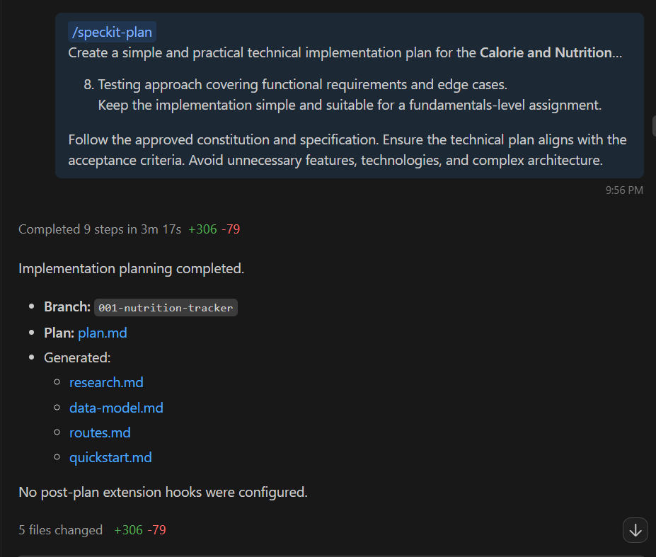

------------------------------------------------------------------------

## 4. Tasks

### 4.1 Output

**Screenshot:** 

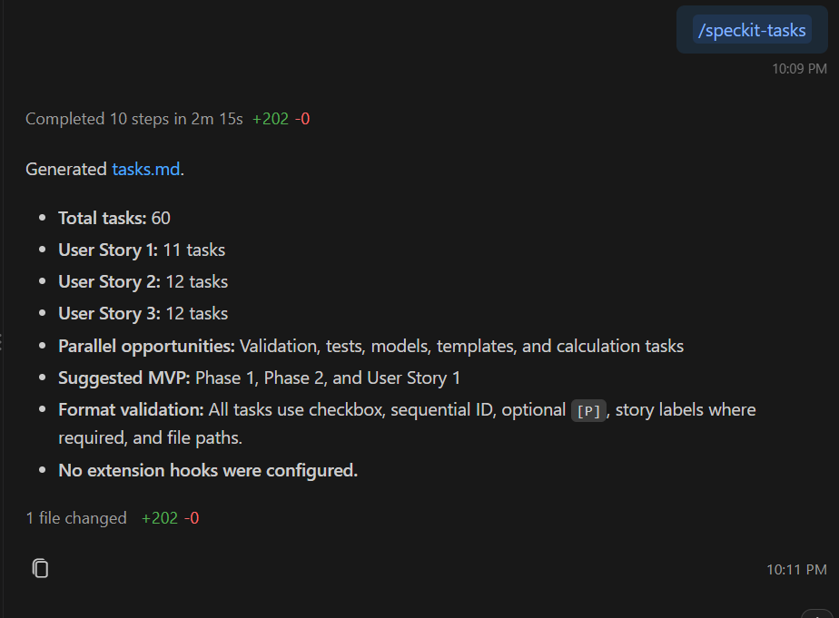

------------------------------------------------------------------------

## 5. Analyze

### 5.1 Output

**Screenshots:** 

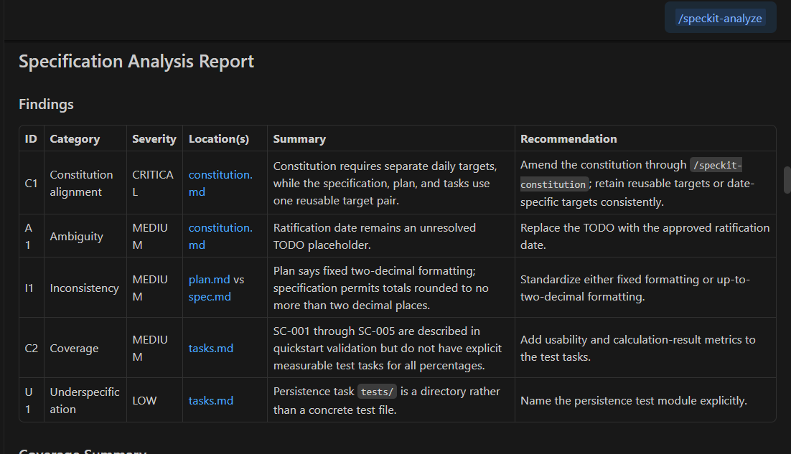

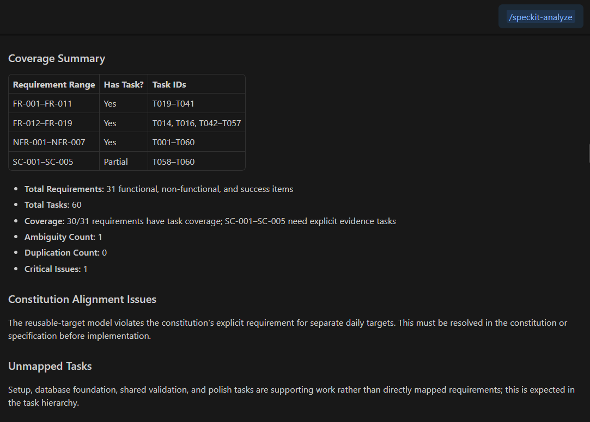

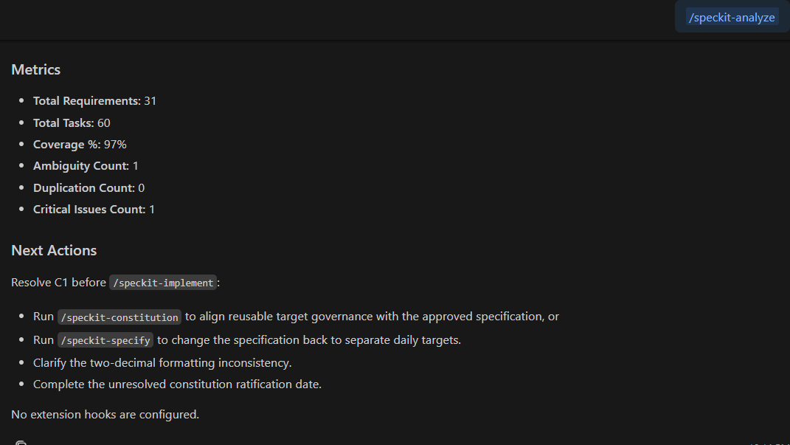

**Corrections prompt:** 

```text
Review the issues identified by `/speckit-analyze` and fix them across the relevant project documents.

1. C1 – Constitution alignment: Update the constitution to specify one reusable pair of calorie and protein targets applicable across all dates, consistent with the specification and plan.
2. A1 – Ratification date: Replace the TODO placeholder with the mentor-approved ratification date. If it is not available, leave it marked as pending confirmation.
3. I1 – Number formatting: Standardize calorie and protein values to allow up to two decimal places across the specification and technical plan.
4. C2 – Testing coverage: Add measurable testing tasks for input validation, calorie and protein calculations, progress percentages, empty meal records, and exceeded targets.
5. U1 – Persistence testing: Specify a concrete persistence test file, such as `tests/test_persistence.py`, instead of referring only to the tests directory.
Update only the necessary files. Maintain consistency across the constitution, specification, plan, and tasks.

Do not introduce new features or change previously approved requirements. Review the changes and report which issues have been resolved and which remain pending.
```

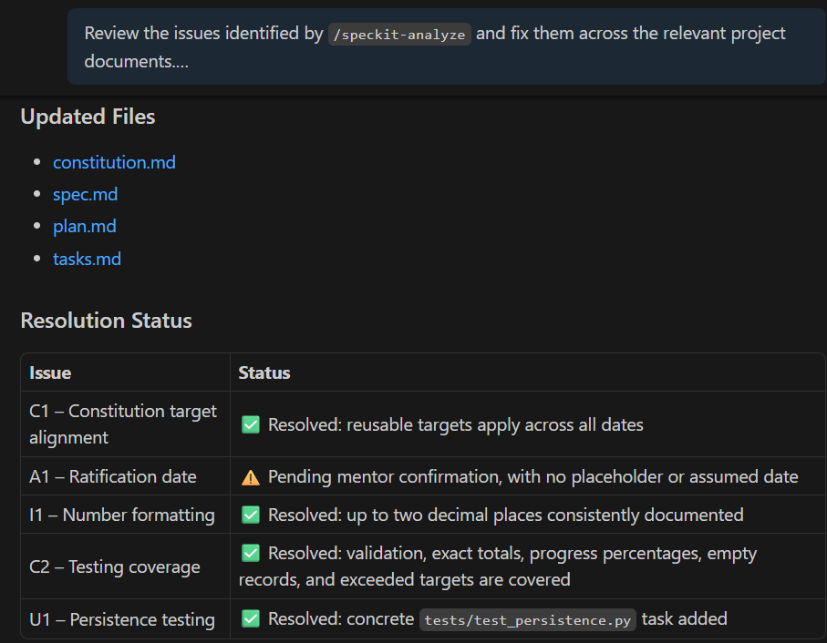

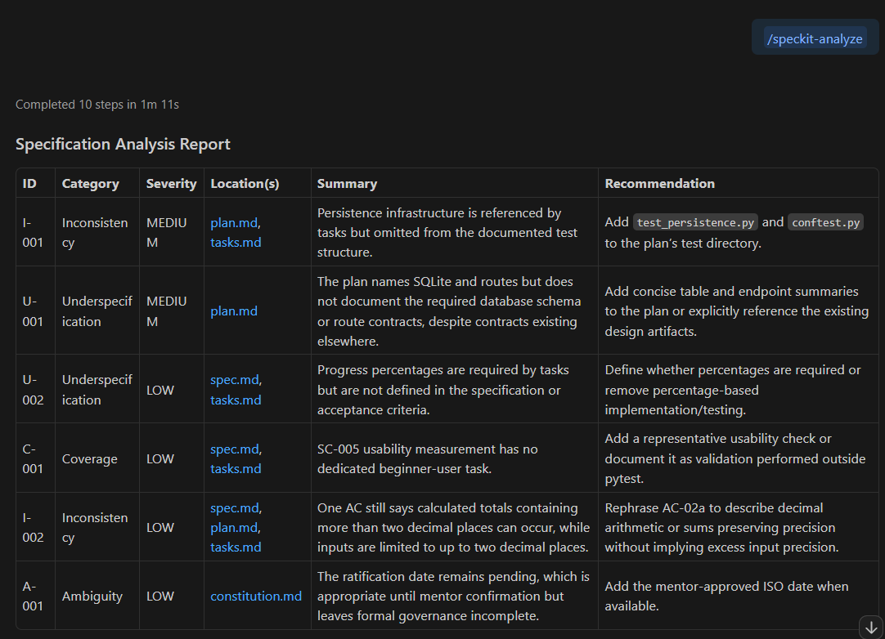

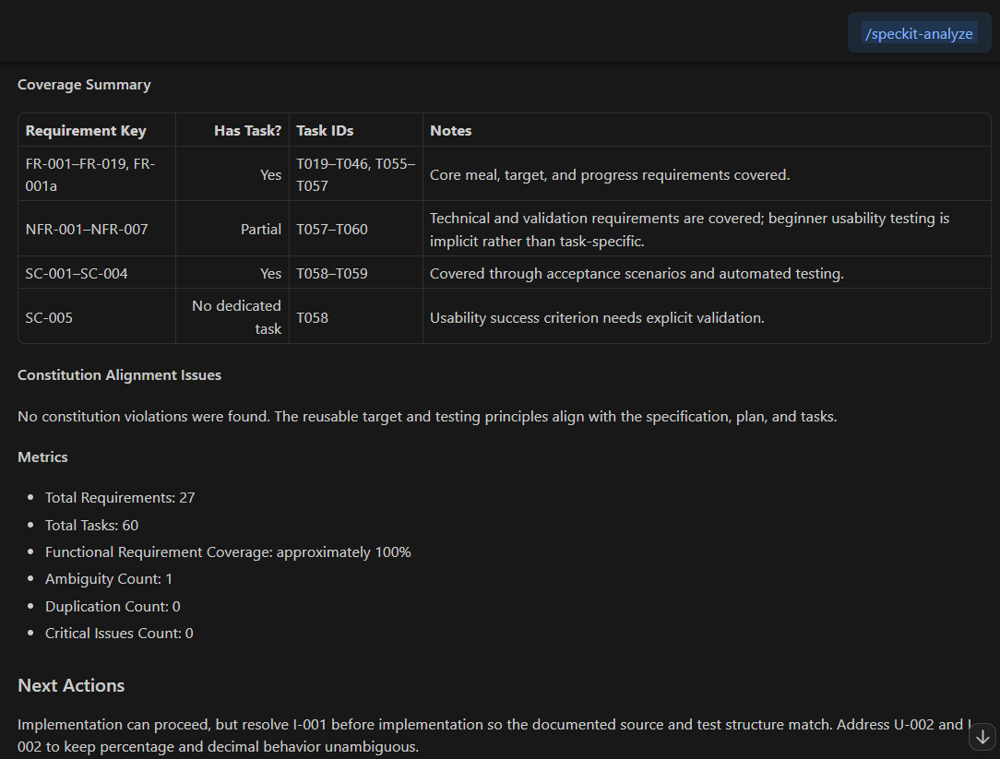

------------------------------------------------------------------------

## 6. Implement

### 6.1 Output

**Screenshot:**

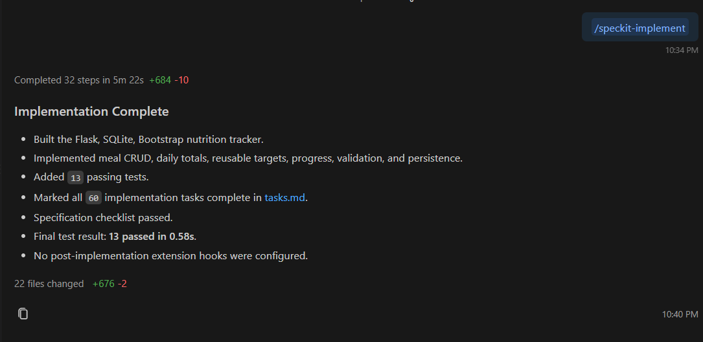

------------------------------------------------------------------------

## 7. UI Enhancement

### 7.1 Specify

**Prompt:** 
```text
Enhance the UI/UX of the existing Calorie and Nutrition Tracker to make it modern, attractive, and user-friendly.

Requirements:

- Use a clean, minimal design with a soft sage-green, white, and neutral color palette.
- Create an attractive dashboard with calorie and protein summary cards.
- Display daily nutrition progress using visually appealing progress bars.
- Improve the Add Meal form with rounded inputs, better spacing, and modern buttons.
- Display recorded meals in organized cards or tables with category icons.
- Add clear visual indicators for remaining and exceeded nutrition targets.
- Ensure responsive design across desktop, tablet, and mobile.
- Add subtle hover effects and smooth transitions.
- Improve empty states and validation message styling.
Constraints:

- Preserve all existing application functionality.
- Do not change business rules, calculations, database structure, or API behavior.
- Continue using Flask, HTML, CSS, Bootstrap, and SQLite.
- Keep the design simple and suitable for a fundamentals-level project.
Define measurable acceptance criteria with unique IDs. Treat this as a UI enhancement to the existing application, not a new project.
```

**Screenshot:** 

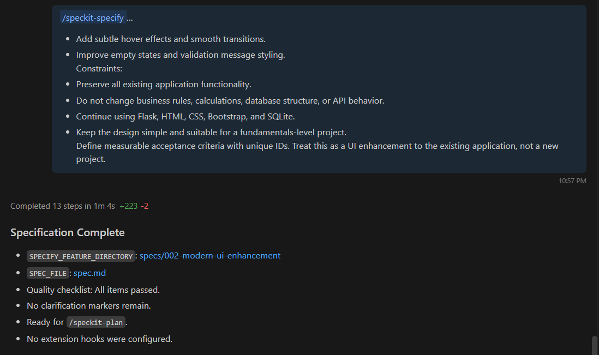

### 7.2 Plan

**Prompts:** 

```text
Create a technical implementation plan for the UI enhancement of the existing Calorie and Nutrition Tracker.

Use the existing technology stack:

- Python and Flask
- HTML
- CSS
- Bootstrap
- SQLite
Plan the improvements for the dashboard, nutrition summary cards, progress indicators, meal listing, Add Meal form, buttons, and responsive layouts.

Include the components to modify, CSS organization, reusable styling, responsive design approach, and implementation sequence.

Preserve all existing backend logic, database operations, API endpoints, and nutrition calculations. Avoid introducing unnecessary dependencies or technologies.
```
**Screenshot:**

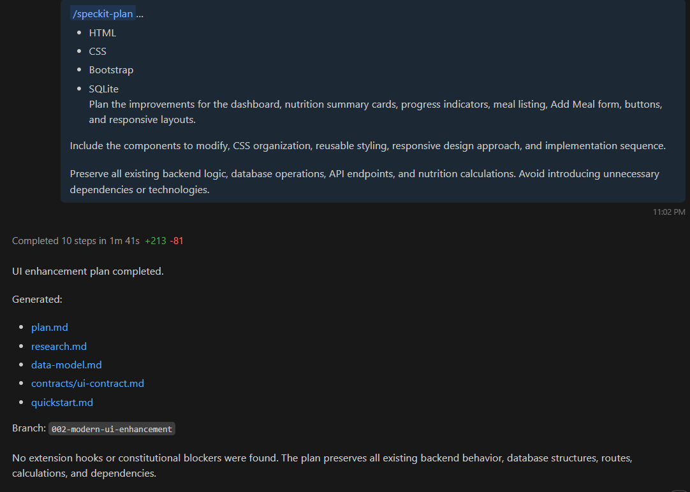

### 7.3 Tasks

**Prompts:** 

```text
Generate actionable implementation and testing tasks based on the approved UI enhancement specification and technical plan.

Include tasks for:

- Updating the overall application layout.
- Improving dashboard summary cards.
- Styling calorie and protein progress indicators.
- Improving the Add Meal form.
- Styling the recorded meals section.
- Adding icons, hover effects, and transitions.
- Implementing responsive layouts.
- Testing UI consistency and existing functionality.
Link every task to its corresponding acceptance criteria. Keep tasks small, specific, and independently verifiable.
```

**Screenshot:**

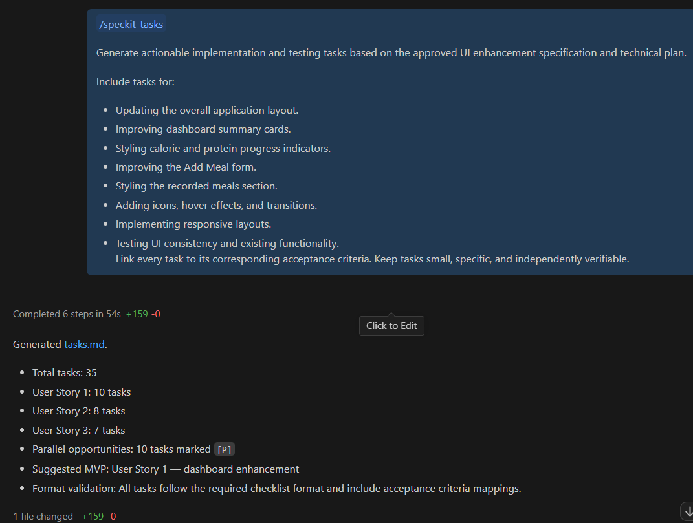


### 7.4 Implement

**Prompt:** 
```text

Implement the approved UI enhancement tasks for the existing Calorie and Nutrition Tracker.

Follow the approved specification and technical plan.

Use a modern wellness-dashboard design with sage green, white, and neutral colors.

Improve the visual appearance of all existing pages, forms, dashboard components, progress indicators, and meal listings.

Ensure:

- Responsive design.
- Consistent styling.
- Clean and maintainable code.
- Existing features continue working.
- All existing business logic and calculations remain unchanged.
Run the available tests and verify that the UI changes have not affected existing functionality. Report completed tasks and any remaining issues.
```

**Screenshot:** 

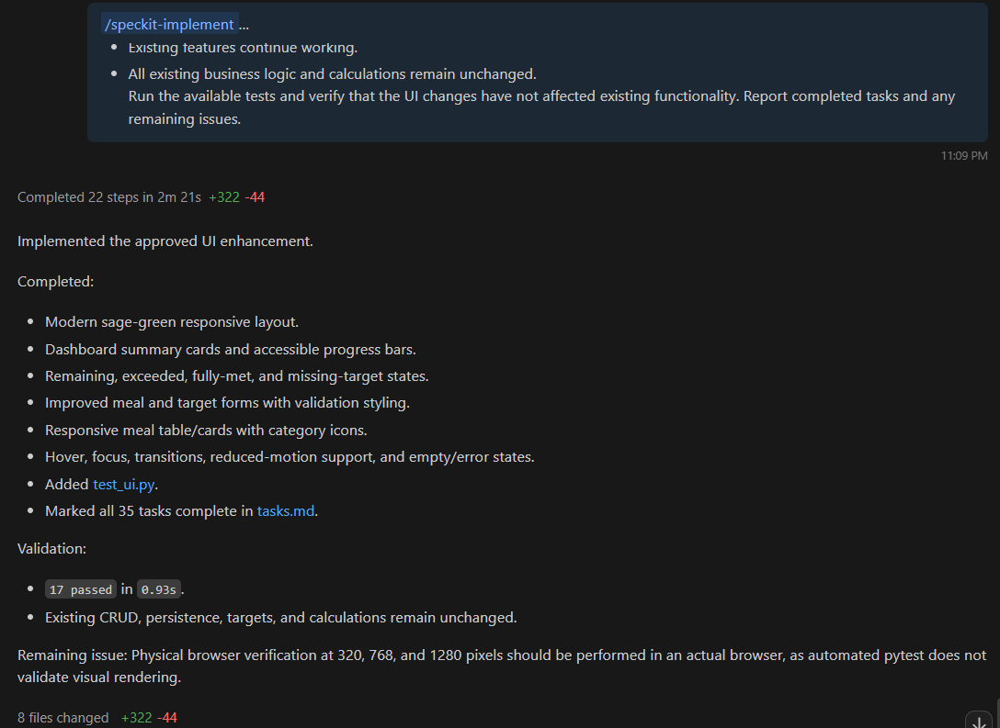

------------------------------------------------------------------------

## 8. Final Output

**Screenshot:** 

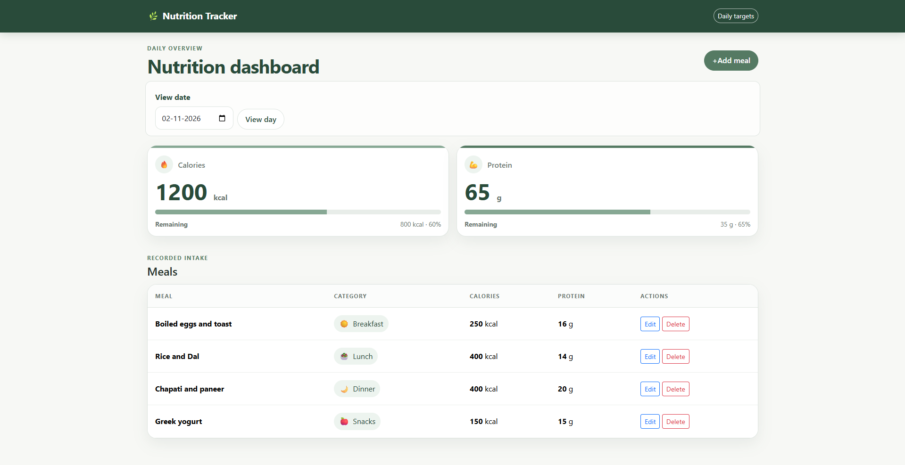

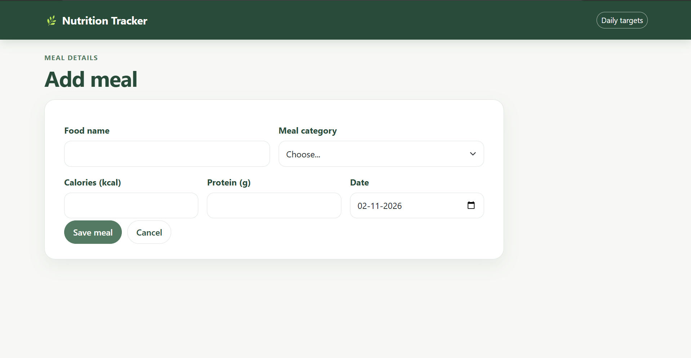

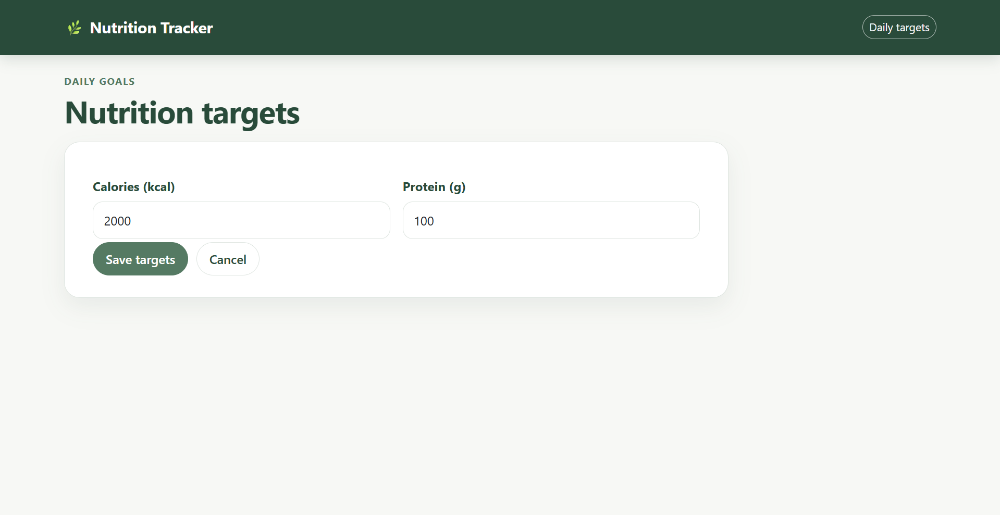


------------------------------------------------------------------------
